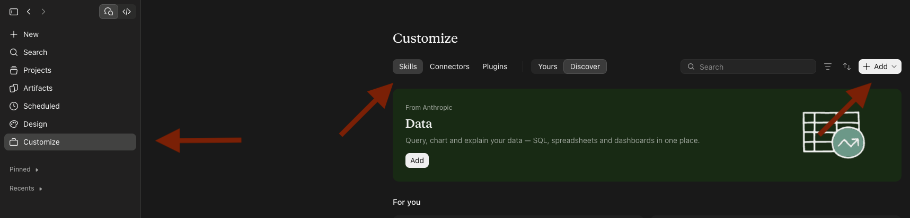
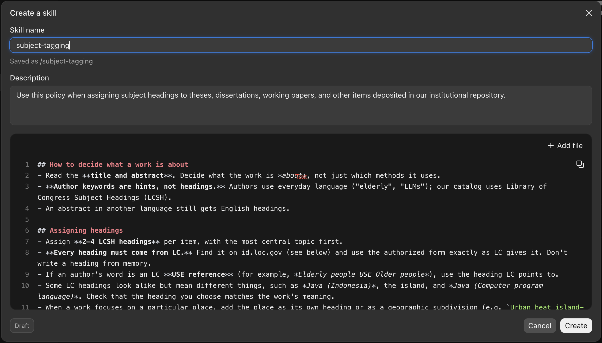
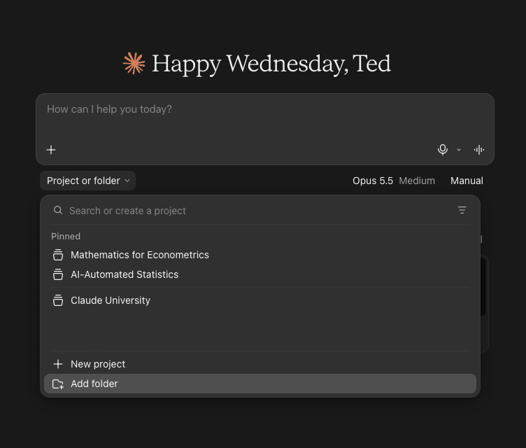
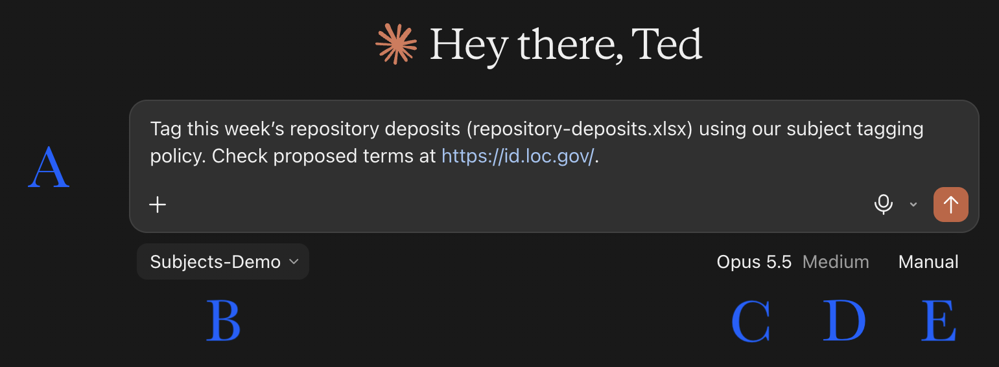
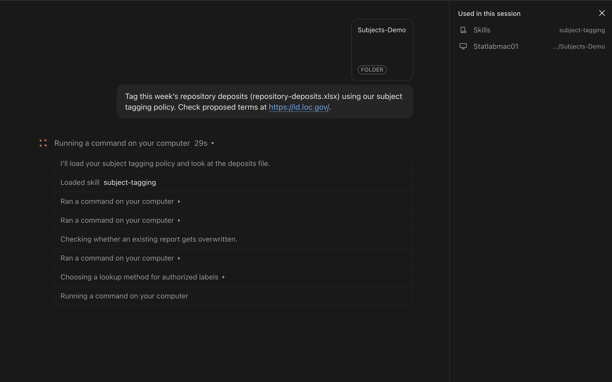
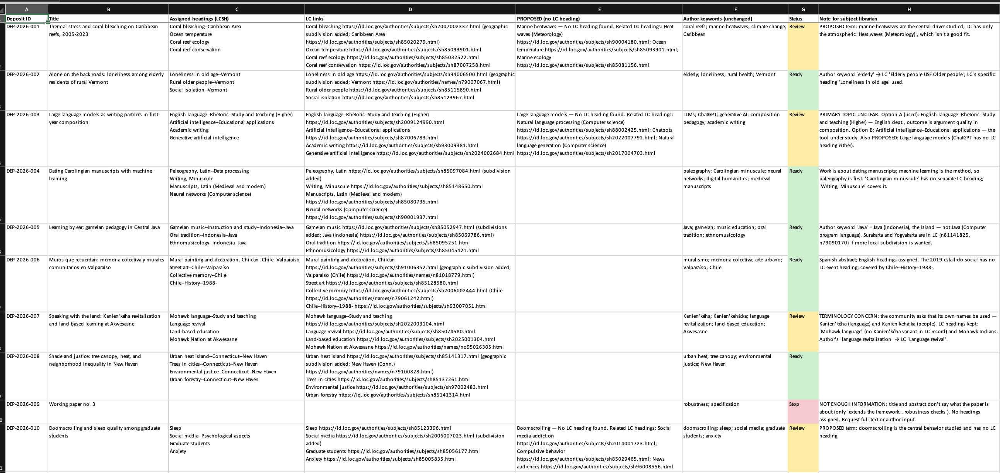

# Intro

## What is Claude Cowork?

Anthropic describes Cowork as bringing "Claude Code's agentic capabilities to knowledge work beyond coding."

- **You describe the result you want.** Claude plans the steps and carries them out.
- **It works with files in folders you choose.** It reads spreadsheets and documents, and writes new ones.
- **It produces finished files:** spreadsheets, documents, and slide decks.
- **It runs in the Claude desktop app.** In the current app, chat and Cowork start from the same message box.

## How it works: a loop

```{=latex}
\begin{center}
\begin{tikzpicture}[every node/.style={font=\small,align=center},
  box/.style={draw=statsecondary,fill=statsecondary!8,rounded corners=3pt,minimum width=2.7cm,minimum height=1.1cm,line width=0.8pt,text=statprimary},
  arr/.style={-{Stealth[length=2mm]},line width=0.9pt,statprimary!55}]
  \node[box] (a) at (0,0)    {Read the request\\and the files};
  \node[box] (b) at (3.6,0)  {Choose the\\next step};
  \node[box] (c) at (7.2,0)  {Act: edit a file,\\run a command,\\look something up};
  \node[box] (d) at (10.8,0) {Check the\\result};
  \draw[arr] (a) -- (b); \draw[arr] (b) -- (c); \draw[arr] (c) -- (d);
  \draw[arr] (d.south) to[out=-120,in=-60] node[below,font=\footnotesize,text=statprimary!80]{repeat until the task is done, or until Claude needs you} (b.south);
\end{tikzpicture}
\end{center}
```

\vspace{0.8em}

- Each step appears in the task window as it happens. You can stop it or redirect it at any point.
- Because it acts on its own between steps, the instructions and permissions you set matter more than in a chat.

## The context window

```{=latex}
\begin{center}
\begin{tikzpicture}[x=1cm,y=1cm,every node/.style={font=\scriptsize}]
  \node[anchor=east,font=\small\bfseries] at (1.8,2.7) {Start};
  \fill[statyale] (2.0,2.38) rectangle (4.9,3.02);
  \draw[statprimary!50,rounded corners=2pt] (2.0,2.38) rectangle (13.0,3.02);
  \node[text=white,align=center] at (3.45,2.7) {request +\\skill};
  \node[text=statprimary!55] at (8.95,2.7) {space for the work};
  \node[anchor=east,font=\small\bfseries] at (1.8,1.45) {Later};
  \fill[statyale] (2.0,1.13) rectangle (4.9,1.77);
  \fill[statsecondary] (4.9,1.13) rectangle (8.1,1.77);
  \fill[statdefinition] (8.1,1.13) rectangle (11.4,1.77);
  \draw[statprimary!50,rounded corners=2pt] (2.0,1.13) rectangle (13.0,1.77);
  \node[text=white,align=center] at (3.45,1.45) {request +\\skill};
  \node[text=white,align=center] at (6.5,1.45) {conversation +\\decisions};
  \node[text=white,align=center] at (9.75,1.45) {file contents +\\step results};
  \node[text=statprimary!55] at (12.2,1.45) {remaining};
\end{tikzpicture}
\end{center}
```

- Claude works from a limited record of the task, called the **context window**: your request, the skill, the conversation, file contents, and the result of each step.
- Long tasks fill it. When it is nearly full, Claude summarizes earlier work to make room. The summary keeps the main points, not every detail.
- Rules that must hold for the whole task belong in a file, such as a skill, that Claude can read again.

## What we'll show today

:::: {.columns}

::: {.column width="44%"}
**Demo 1 · Jordan**\
Building slide decks: what Cowork can make.

\vspace{0.8em}
**Demo 2 · Ted**\
Tagging repository deposits: where Cowork stops and asks.
:::

::: {.column width="56%"}
\small
Four things to watch for in both demos:

- **Skill files:** written instructions, such as a local policy, that Claude follows each time.
- **Permissions:** Claude works only in folders you connect, and can be set to ask before each action.
- **Stop conditions:** Claude stops and asks when information is missing or it can't check something.
- **Delegation boundary:** some decisions stay with staff, such as approving headings or deleting originals.
:::

::::

# Demo 1

## Demo 1

<!-- TODO (Jordan): Building slide decks with Claude Cowork (15 min) -->

## Questions?

<!-- Short Q&A (5 min) -->

# Demo 2: Subject Tagging

## How subject tagging works today

\centering
\subjectloop{statyale}{decides}{0}

## The same loop, with Claude

:::: {.columns}

::: {.column width="70%"}
\centering
\resizebox{\linewidth}{!}{\subjectloop{statdefinition}{verifies}{1}}
:::

::: {.column width="30%"}
```{=latex}
\small
\textcolor{statdefinition}{\rule{0.7em}{0.7em}}~\textbf{Claude does steps 1--5.} The rules it follows are written in a \textbf{skill}.

\vspace{0.8em}
\textcolor{statyale}{\rule{0.7em}{0.7em}}~\textbf{The librarian does step 6.} Claude sends every flag, PROPOSED term, and unclear topic to the librarian.

\vspace{0.8em}
\textcolor{statprimary!70}{\texttt{\scriptsize Grey labels}} show what Claude reads: the deposits spreadsheet in the connected folder, and LC's lookup service.
```
:::

::::

## The task

Ten new theses and working papers were deposited in the institutional repository this week. Each one needs Library of Congress subject headings. Unclear cases go to a subject librarian.

The policy (how to tag, when to stop, what to send to a librarian) is in a **skill**.

## What is a skill?

```{=latex}
\begin{definitionblock}[A skill]
A plain-text file of instructions, such as a local policy. Claude loads it when a task matches its description, and follows it each time.
\end{definitionblock}
```

- **No code, no training.** It's ordinary text with headings and bullet points.
- **Name and description** tell Claude *when* to use it.
- **Instructions** tell Claude *how*: the rules, when to stop, and what to send to people.
- **Once saved**, it's available in every new chat.
- **Best for bounded, repetitive tasks with a clear workflow**, like tagging a weekly batch of deposits.


## Step 1: Create a skill



1. Click **Customize** in the left sidebar.
2. Open the **Skills** tab.
3. Click **+ Add** and create a new skill.

## Step 2: Write the skill

:::: {.columns}

::: {.column width="58%"}
\vspace{1em}
{width=100%}
:::

::: {.column width="42%"}
\small
- **Skill name:** how you'll recognize it.
- **Description:** tells Claude when to use the skill. *"Use this policy when assigning subject headings to theses, dissertations, working papers, and other items deposited in our institutional repository."*
- **Instructions:** the policy itself, in six sections: how to decide what a work is about · assigning headings · looking up headings at LC · flag for the subject librarian · output · never.
- Click **Create**. It's saved to your account.
:::

::::

## Anatomy of a Skill: the rules

What Claude does on every item, in the skill's own words:

- "Read the **title and abstract**. Decide what the work is *about*, not just which methods it uses."
- "**Author keywords are hints, not headings.** Authors use everyday language ('elderly', 'LLMs'); our catalog uses Library of Congress Subject Headings."
- "**Every heading must come from LC.** Find it on id.loc.gov and use the authorized form exactly as LC gives it. Don't write a heading from memory."
- "If an author's word is an LC **USE reference** (for example, *Elderly people USE Older people*), use the heading LC points to."
- "Assign **2–4 LCSH headings** per item, with the most central topic first."
- Every item gets a **Status**: *Ready* (every heading verified, no flags), *Review* (a flag, a PROPOSED term, or an unverified heading), or *Stop* (not enough information).

## Anatomy of a Skill: stop conditions

When the answer isn't in the data, Claude **stops and says so** instead of guessing:

- **Not enough information:** *"If the title and abstract don't say what the work is about, **assign nothing** for that item and ask for the full text or the author's input."*
- **No LC heading:** *"If a central concept has no LC heading, don't force a poor fit and don't invent a heading. List the concept as **PROPOSED**."*
- **No guessing about LC:** *"If the service can't be reached, say so in the report. **Don't answer from memory** about whether LC has a heading."*
- **No bot checks:** *"If a bot check, CAPTCHA, or 'verify you are human' page appears anyway, don't try to solve it."*


## Anatomy of a Skill: delegation boundaries

The skill lists the decisions Claude must leave to people.

:::: {.columns}

::: {.column width="50%"}
**Flag for the subject librarian** *(don't decide these yourself)*

- **Primary topic unclear:** *"Give both options and say why."*
- **Terminology concerns:** *"Keep the LC heading, note the preferred term, and flag it. Don't substitute."*
:::

::: {.column width="50%"}
**Never**

- *"Change or delete* repository-deposits.xlsx*."*
- *"Submit a heading proposal to LC, or add headings to any local list. Only the subject team does that."*
- *"Publish, upload, or send anything. This is a draft for review."*
:::

::::


## Skills guide; permissions enforce

:::: {.columns}

::: {.column width="50%"}
```{=latex}
\begin{block}{Skill = the policy manual}
\begin{itemize}
\item Written by you, in plain English
\item Claude \emph{follows} it
\item ``Never change or delete repository-deposits.xlsx''
\end{itemize}
\end{block}
```
:::

::: {.column width="50%"}
```{=latex}
\begin{block}{Permissions = the system settings}
\begin{itemize}
\item Set in the app, not in the text
\item Claude \emph{can't get around} them
\item It sees only the folder you connect, and must ask before reaching another one
\end{itemize}
\end{block}
```
:::

::::

\vspace{0.6em}
Libraries already work this way: the cataloging manual says what staff should do; ILS permissions control what they can edit.

## Step 3: Choose the folder

:::: {.columns}

::: {.column width="50%"}
{height=78%}
:::

::: {.column width="50%"}
- Below the chat box: **Project or folder $\rightarrow$ Add folder**.
- Pick **Subjects-Demo**. It holds the deposits spreadsheet.
- **Claude sees only this folder.** The answer key sits in a different folder that isn't connected, so Claude can't read it.
- Need another folder? Claude **has to ask you** first.
:::

::::

## Step 4: The prompt window

:::: {.columns}

::: {.column width="50%"}
\vspace{1.5em}

:::

::: {.column width="50%"}
\small
- \textcolor{statsecondary}{\textbf{A · Chat box.}} The request, in plain English. It names the file and the policy; the LC link says where to check.
- \textcolor{statsecondary}{\textbf{B · Folder.}} What Claude can see and change. **This sets the permissions.**
- \textcolor{statsecondary}{\textbf{C · Model.}} Which Claude does the work (here, Opus 5.5).
- \textcolor{statsecondary}{\textbf{D · Effort.}} How much thinking Claude does before acting. Higher is more careful, but slower.
- \textcolor{statsecondary}{\textbf{E · Permissions mode.}} *Manual:* Claude asks before each action. *Auto:* Claude checks each action for safety and blocks unsafe ones. *Skip:* no checks.
:::

::::

## Step 5: The live run

:::: {.columns}

::: {.column width="64%"}
{width=100% height=85%}
:::

::: {.column width="36%"}
\small
- **"Loaded skill subject-tagging."** Claude matched the request to the skill's description. We never named the file.
- **"Used in this session"** (right panel) lists the skill and the folder Claude used.
- **"Ran a command on your computer"** means reading the spreadsheet, querying LC, or writing the output. Click $\blacktriangleright$ to see exactly what ran.
:::

::::

## Step 6: The output

{width=100% height=74%}

\small A new file, **repository-deposits.subjects.xlsx**, with one row per deposit. The original spreadsheet is untouched.

## How to read the output

Read **Status** first, then the **Note** for every row that isn't green.

- \textcolor{statsecondary}{\textbf{Assigned headings (LCSH):}} 2--4 per deposit, most central topic first, each found and verified at id.loc.gov.
- \textcolor{statsecondary}{\textbf{LC links:}} one link per heading, to LC's record. Click any of them to check.
- \textcolor{statsecondary}{\textbf{PROPOSED (no LC heading):}} concepts LC doesn't have a heading for, with related LC headings for the librarian to consider.
- \textcolor{statsecondary}{\textbf{Author keywords (unchanged):}} compare with the assigned headings to see how everyday words became LC headings.
- \textcolor{statsecondary}{\textbf{Status:}} \colorbox{green!15}{Ready} \colorbox{yellow!30}{Review} \colorbox{red!15}{Stop}.
- \textcolor{statsecondary}{\textbf{Note for subject librarian:}} the reason behind every Review and Stop.

\vspace{0.3em}
**This run:** 5 Ready · 4 Review · 1 Stop, with 49 links to LC records.

## Reading the decisions: rules applied

\footnotesize

| Deposit | What Claude did | Skill rule |
|:------|:----------|:--------|
| **002** Loneliness, rural Vermont | Author's "elderly": LC says *Elderly people USE Older people*. Claude used *Loneliness in old age\-\-Vermont* and *Rural older people\-\-Vermont*. | "If an author's word is an LC USE reference, use the heading LC points to." |
| **005** Gamelan in Central Java | *Gamelan music\-\-Instruction and study\-\-Indonesia\-\-Java*, using *Java (Indonesia)*, **not** *Java (Computer program language)* | "Some LC headings look alike but mean different things." |
| **006** Murals in Valparaíso | Spanish abstract $\rightarrow$ *Mural painting and decoration, Chilean\-\-Chile\-\-Valparaíso*; *Street art*; *Collective memory* | "An abstract in another language still gets English headings." |
| **010** Doomscrolling and sleep | PROPOSED *Doomscrolling*: "No LC heading found." Related: *Social media addiction*, *Compulsive behavior* | "If a central concept has no LC heading … list the concept as PROPOSED." |

## Reading the decisions: sent to the librarian

\footnotesize

| Deposit | What the Note says | Skill rule |
|:------|:----------|:--------|
| **003** Large language models in first-year composition | "PRIMARY TOPIC UNCLEAR. Option A (used): *English language\-\-Rhetoric\-\-Study and teaching (Higher)* … Option B: *Artificial intelligence\-\-Educational applications* — the tool under study." | "Give both options and say why." |
| **007** Kanien'kéha revitalization at Akwesasne | "TERMINOLOGY CONCERN: the community asks that its own names be used — Kanien'kéha (language) and Kanien'kehá:ka (people). LC headings kept: 'Mohawk language' (no Kanien'kéha variant in LC record) …" | "Keep the LC heading, note the preferred term, and flag it. Don't substitute." |
| **009** "Working paper no. 3" | "NOT ENOUGH INFORMATION: title and abstract don't say what the paper is about … No headings assigned. Request full text or author input." | "Assign nothing for that item." |

# Q&A

## Q&A
